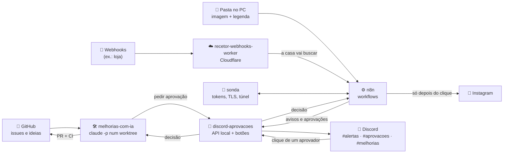

# KCU Automações 🤖

**As automações que trabalham por nós, mas nunca decidem por nós.** A IA analisa pedidos no GitHub e prepara pull requests, o n8n prepara publicações e vigia o que é público, os webhooks chegam mesmo com o site protegido contra robôs. Tudo o que é importante passa por um **botão no Discord**, e só nós carregamos nele.

> São as mesmas automações que usamos todos os dias, só que limpas de tudo o que é nosso. Pega, lê, adapta ao teu.
>
> *Automations we run every day: Discord approval buttons with a small local API, GitHub issue → AI analysis (headless Claude Code) → PR → approve in Discord, a Cloudflare Worker that queues signed webhooks for your homelab, and n8n workflows for Instagram token refresh, uptime, expiry reminders and approved Instagram publishing. (In Portuguese.)*

## Como encaixa

## O que está aqui

| Pasta | O que faz | Corre em |
|---|---|---|
| [`discord-aprovacoes`](discord-aprovacoes) | Avisos e pedidos de aprovação com botões num canal do Discord; só os aprovadores da lista podem carregar. API local (`/aviso`, `/aprovacao`) com token e lista de IPs, estado em SQLite, serviço systemd. | Linux (VM, LXC, Raspberry Pi) |
| [`melhorias-com-ia`](melhorias-com-ia) | Issue ou ideia no GitHub → análise com o Claude Code sem interface (a tua subscrição) num git worktree → PR + CI → **Aprovar/Recusar** no Discord → junta ou fecha com um comentário educado. | o teu PC (Windows ou Linux) |
| [`recetor-webhooks-worker`](recetor-webhooks-worker) | Cloudflare Worker que recebe webhooks assinados (Standard Webhooks), guarda-os numa fila e deixa a casa ir buscá-los. Resolve o 403 do *Bot Fight Mode*. Com testes. | Cloudflare + Linux |
| [`n8n`](n8n) | Workflows prontos a importar: renovar tokens do Instagram, vigia de uptime, lembretes do que caduca, publicar no Instagram com aprovação, avisar erros. E a sonda que os ajuda. | n8n em Docker |

Cada pasta tem o seu README: o que faz, o que precisas, como instalar, a configuração, como testar e como desligar.

## Princípios

- **Nada público sem um clique humano.** Nem um PR no ramo principal, nem um comentário numa issue, nem uma publicação no Instagram. A IA e os workflows preparam; uma pessoa da lista de aprovadores decide.
- **Uma vez só.** Cada aprovação só pode ser executada uma vez (`reservar`): dois cliques, um callback repetido ou uma tarefa agendada nunca fazem nada a dobrar.
- **Nunca falar com clientes sozinho.** Estas automações não mandam mensagens a ninguém em teu nome. Avisam-te a ti.
- **Nunca gastar dinheiro.** Nada aqui compra, paga ou mexe em preços. A análise com IA usa o login da tua subscrição do Claude e tira do ambiente qualquer chave de API paga (`ANTHROPIC_*`). O Worker cabe no plano gratuito da Cloudflare.
- **Segredos só em ficheiros de ambiente** (`chmod 600`) ou variáveis de utilizador, nunca no código nem nos JSON. Os exemplos (`.env.exemplo`, `config.exemplo.json`) não têm valores. O `.gitignore` deixa de fora os ficheiros reais.
- **APIs só na rede de casa**, com token **e** lista de IPs. O que tem de estar na Internet (o Worker, o webhook da imagem do Instagram) só aceita pedidos assinados ou com uma chave de uso curto.
- **Testar sem consequências.** Tudo tem um modo `[teste]`: cliques simulados, contentores do Instagram que nunca são publicados, avisos marcados.

## Começar

1. Instala o [`discord-aprovacoes`](discord-aprovacoes) e confirma com `ferramenta.py aviso-teste alertas`.
2. Escolhe o resto pela ordem que te der jeito: cada pasta só depende do `discord-aprovacoes`.

## Episódios

| Ep. | Vídeo | Código | O que mudou |
|---|---|---|---|
| 00 | *em breve* | [ep00](../../tree/ep00) | Primeira versão pública |

O que mudou em cada versão está no [CHANGELOG](CHANGELOG.md).

## FAQ

**Preciso de tudo isto?**
Não. O `discord-aprovacoes` é a base; o resto é à escolha. Os workflows de *uptime* e prazos, por exemplo, só precisam dele e do n8n.

**Posso usar o bot que já tenho no servidor?**
Podes: o serviço liga-se como uma segunda sessão com `Intents.none()` e só trata os botões com o seu prefixo. Os cuidados estão no [README do discord-aprovacoes](discord-aprovacoes#opção-b--uma-segunda-sessão-de-um-bot-que-já-tens). Se não quiseres pensar nisso, cria um bot só para isto.

**A IA pode fazer asneiras no meu repositório?**
Pode propor asneiras, não as pode juntar. Corre num worktree separado, só lê e edita ficheiros (sem terminal nem web), as regras recusam alterações grandes, em caminhos proibidos ou com dados privados, e o ramo principal só muda com o teu clique e o CI verde.

**Quanto custa?**
Com uma subscrição do Claude que já tenhas, o plano gratuito da Cloudflare e o n8n *self-hosted*: 0 € extra.

**Funciona com Slack ou Telegram em vez do Discord?**
Não tal como está. A lógica (estado, reserva, callbacks) está separada do desenho da mensagem em [`aprovacao.py`](discord-aprovacoes/aprovacao.py), por isso dá para adaptar.

**Tenho uma ideia.**
Vai às [Discussions](https://github.com/orgs/KCUServices/discussions/categories/ideas).

## Mais da KCU Services

O setup completo onde isto corre está no [kcu-stack](https://github.com/KCUServices/kcu-stack). Outros projetos em [github.com/KCUServices](https://github.com/KCUServices).

## Licença

[PolyForm Noncommercial 1.0.0](LICENSE): podes usar, estudar, alterar e partilhar **para uso pessoal e sem fins comerciais**. Vender, revender ou usar isto num negócio precisa de autorização: fala connosco no Instagram [@kcu.services](https://www.instagram.com/kcu.services).

**Marca e imagens:** o nome KCU, os logótipos e as imagens dos produtos são da KCU Services, com todos os direitos reservados. A licença cobre só o código e a documentação. Ver [MARCA.md](MARCA.md).
