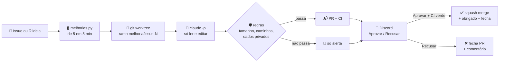

# Melhorias com IA 🛠️

Alguém abre uma **issue** (ou uma ideia nas *Discussions*) num repositório teu. Uns minutos depois tens no Discord um alerta com o que foi pedido, o que a IA encontrou no código e, se fizer sentido, um **pull request já preparado**, com o CI a correr. Carregas **✅ Aprovar** e ele junta-se ao ramo principal, agradece na issue e fecha-a. Carregas **❌ Recusar** e o PR é fechado com um comentário educado.

**Nada entra no ramo principal e nada é publicado sem o teu clique.**



## Como funciona

Cada volta (tarefa agendada, de 5 em 5 minutos):

1. **Decisões.** Pergunta ao [Discord aprovações](../discord-aprovacoes) que botões foram carregados (modo *puxar*: o PC só faz pedidos para fora, não precisa de portas abertas) e executa-os.
2. **CI.** Atualiza o estado do GitHub Actions no alerta (🟡 a correr, 🟢 verde, 🔴 falhou).
3. **Pedidos novos.** Procura issues abertas e ideias nas categorias de *Discussions* que escolheres, criadas depois da data `inicio`.
4. **Análise.** Analisa **um** pedido por volta com o **Claude Code sem interface** (`claude -p`):
   - num **git worktree** separado, num ramo `melhoria/issue-N`, nunca na tua cópia de trabalho;
   - só com as ferramentas `Read, Edit, Write, Glob, Grep` (sem terminal, sem web, sem subagentes, sem servidores MCP), `--max-turns` e tempo máximo;
   - o texto do pedido vai entre marcas e o [prompt](prompt_analise.md) diz que é só *dados* (proteção contra *prompt injection*);
   - devolve um JSON com veredicto, resumo, análise, riscos e título do PR.
5. **Regras antes de qualquer push.** O `melhorias.py` recusa a alteração se mexer em `caminhos_proibidos` (ex.: `.github/workflows/`, `LICENSE`), se tiver binários, se passar de `max_ficheiros` ou `max_linhas`, ou se alguma linha nova bater num dos teus `padroes_privados.txt`. Os títulos, textos de PR e comentários públicos passam pelos mesmos padrões. Se tiveres um hook `pre-push`, ele corre também.
6. **Aprovar** só junta com o **CI verde** (`gh pr merge --squash --match-head-commit`, para não juntar um commit diferente do que viste). Se o CI ainda estiver a correr, espera; se falhou, não junta e os botões voltam.

### A tua subscrição, não uma chave paga

O `melhorias.py` **tira todas as variáveis `ANTHROPIC_*` do ambiente** antes de chamar o `claude`. Assim o Claude Code usa o login que fizeste nesse PC (a tua subscrição) e nunca uma chave de API que esteja definida por engano. Também tira o `APROVACOES_TOKEN`: o agente não precisa de nenhum segredo. Há um limite de análises por dia (`max_analises_dia`) contra spam: acima disso chega só um alerta «não analisado».

## O que precisas

- O [Discord aprovações](../discord-aprovacoes) a correr, com um canal `melhorias` (`CANAL_MELHORIAS_ID`) e o IP deste PC em `API_ORIGENS`.
- Neste PC (Windows ou Linux): Python 3.10+, `git`, o [GitHub CLI](https://cli.github.com/) com login (`gh auth login`) numa conta que pode fazer push e juntar PRs nos repos, e o [Claude Code](https://docs.claude.com/en/docs/claude-code) com login (`claude`, uma vez, à mão).
- Um clone local de cada repositório que queres vigiar.
- Um workflow de CI nos repos (o *merge* só acontece com os checks verdes).

## Instalar

1. Copia esta pasta para o PC, por exemplo `C:\melhorias-com-ia`.
2. `config.exemplo.json` → `config.json` e preenche (tabela abaixo).
3. `padroes_privados.exemplo.txt` → `padroes_privados.txt` e **acrescenta os teus dados** (nome, utilizador, domínio, pastas). Sem este ficheiro nada é publicado.
4. Guarda o token do serviço de aprovações numa variável de utilizador (nunca no `config.json`):

   ```powershell
   [Environment]::SetEnvironmentVariable('APROVACOES_TOKEN', 'o-API_TOKEN-do-servico', 'User')
   ```

5. Confirma tudo: `python melhorias.py --verificar`.
6. Tarefa agendada: `powershell -ExecutionPolicy Bypass -File instalar_tarefa.ps1`. Em Linux, usa o [`melhorias.service`](melhorias.service) + [`melhorias.timer`](melhorias.timer) como serviço de utilizador (instruções no topo do ficheiro).

## Configuração (`config.json`)

| Chave | Para quê |
|---|---|
| `org` | organização ou utilizador do GitHub |
| `repos` | `{"nome-do-repo": "pasta do clone local"}` |
| `ramo_base` | ramo principal (`main`) |
| `categorias_discussao` | *slugs* das categorias de *Discussions* a vigiar (`[]` = só issues) |
| `inicio` | só pedidos criados depois desta data (evita analisar o histórico todo no 1.º dia) |
| `aprovacoes.url` / `canal` / `origem` | onde está o serviço de aprovações e em que canal aparecem os alertas |
| `programas` | caminhos do `gh`, `git` e `claude` (por omissão, os do `PATH`) |
| `modelo`, `max_turnos`, `tempo_max_agente_s` | limites do Claude Code |
| `max_analises_dia`, `max_ficheiros`, `max_linhas` | limites contra spam e alterações grandes |
| `caminhos_proibidos` | o agente pode sugerir, mas estas pastas e ficheiros nunca vão num PR |
| `padroes_privados` | ficheiro com os padrões que nunca podem ser públicos |
| `autor_commits` | nome e e-mail dos commits (vazio = o do teu `git config`) |
| `textos` | comentário de agradecimento (`{pr}` = número do PR) e de recusa |

## Testar

1. Abre uma issue num dos repos com o título a começar por `[teste]`, por exemplo «[teste] corrigir gralha no README», e escreve uma gralha real.
2. Corre uma volta à mão: `python melhorias.py` (ou espera 5 min). O log está em `logs\melhorias.log`.
3. No Discord aparece o alerta com o PR. Carrega em **Recusar** (ou, no servidor do serviço, `ferramenta.py simular apr-mel-<repo>-i<N> recusar`).
4. Na volta seguinte: PR fechado, ramo apagado, comentário na issue, issue fechada como *not planned*. O ramo principal não mudou.

`python melhorias.py --estado` mostra o que o PC sabe de cada pedido (`estado.json`, é isto que evita alertas repetidos).

## Desligar

- Parar as análises: `schtasks /Change /TN Melhorias-IA /Disable` (voltar: `/Enable`), ou `instalar_tarefa.ps1 -Remover`. Em Linux: `systemctl --user disable --now melhorias.timer`.
- Os alertas que já estão no Discord ficam; cliques feitos com o PC desligado ficam guardados no serviço e são executados quando o PC voltar.
- Os worktrees temporários ficam em `trabalho\` e são apagados quando decides; podes apagar a pasta à mão com a tarefa parada.
