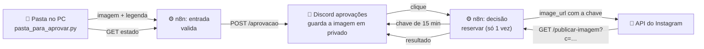

# Publicar no Instagram com aprovação no Discord 📸

Pões uma imagem e a legenda numa pasta do PC. Dois minutos depois tens no Discord a pré-visualização, a legenda e os botões. **Nada é publicado sem o teu clique.**

```
imagem.jpg            a imagem (JPEG ou PNG; o PNG é convertido para JPEG se tiveres o Pillow)
imagem.txt            a legenda
imagem.quando.txt     (opcional) hora, ex.: 2026-11-30 18:30
imagem.teste.txt      (opcional) modo teste: o Instagram vai buscar a imagem, mas nada é publicado
```

Botões:

- **✅ Publicar agora** — publica; a mensagem fica verde com o link; os ficheiros vão para `publicados/`.
- **🕒 Publicar à hora marcada** — só aparece com `.quando.txt`. Fica «Agendado» com **Publicar já** e **Cancelar**; o n8n publica sozinho à hora (até 5 min depois).
- **✏️ Editar** — responde-te com o ficheiro a mudar; mudas, gravas e chega uma aprovação nova.
- **❌ Não publicar** — fecha; os ficheiros vão para `recusados/`.

Tirar a imagem da pasta antes de decidir **cancela** a aprovação. Mudar o ficheiro enquanto está à espera **substitui-a**.

## Como funciona



1. **Validação** (antes de te pedir aprovação): JPEG, ≤ 8 MB, proporção entre 4:5 e 1,91:1, largura ≥ 320 px (aviso abaixo de 1080), legenda não vazia, ≤ 2200 caracteres, ≤ 30 hashtags, ≤ 20 menções, hora marcada entre +10 min e +60 dias, e **privacidade**: bloqueia e-mails que não sejam do teu domínio, telefones, IPs, endereços da rede de casa e os nomes que puseres em `NOMES`. Se falhar: aviso laranja sem botões e um `imagem.erro.txt` ao lado da imagem.
2. **Uma vez só:** quando carregas, o serviço chama o webhook de decisão do n8n, e o n8n faz `reservar`. O serviço só deixa reservar **uma vez**, por isso dois cliques, um callback repetido ou a volta das agendadas nunca publicam a dobrar.
3. **Publicação:** quota do Instagram → chave temporária → `POST /media` (contentor) → espera `FINISHED` → `POST /media_publish` → link.

### A imagem pública de uso único

A API do Instagram só aceita um `image_url` **público em HTTPS**: não dá para enviar o ficheiro. Em vez de pôr a imagem numa pasta pública (arriscado) ou usar o link do anexo do Discord (assinado, caduca e fica público), a imagem **nunca sai do serviço** de aprovações (ficheiro `600`, sem acesso de fora). No momento de publicar:

1. o n8n pede ao serviço uma **chave aleatória (32 bytes) válida 15 minutos**;
2. dá ao Instagram `https://<o-teu-n8n>/webhook/publicar-imagem?c=<chave>`;
3. esse webhook público do n8n pergunta ao serviço pela chave (com o token) e devolve os bytes com `Cache-Control: no-store` e `noindex`. Sem chave válida: 404;
4. logo depois de publicar (ou recusar), a imagem e a chave são apagadas. As chaves que sobram caducam em 15 min; imagens de aprovações fechadas são apagadas ao fim de 7 dias.

Só este webhook precisa de estar acessível da Internet. Os outros (entrada, estado, decisão) ficam na rede de casa.

## Requisitos

- Conta **profissional** do Instagram (Business ou Creator) e uma app na Meta com *Instagram API with Instagram Login* e a permissão `instagram_business_content_publish`.
- Um token de longa duração numa credencial **Header Auth** (`Authorization` / `Bearer IGAA…`) — renovado pelo [tokens-instagram](../tokens-instagram).
- O n8n com o caminho `/webhook/publicar-imagem` acessível por HTTPS da Internet (túnel, *reverse proxy*).
- O [Discord aprovações](../../discord-aprovacoes) com `CALLBACK_PREFIXO` a apontar para o teu n8n (ex.: `http://10.0.0.20:5678/webhook/`) e o IP do n8n em `API_ORIGENS`.
- No PC: Python 3.10+ e, opcional, o [Pillow](https://pypi.org/project/pillow/) (`pip install pillow`) para converter PNG e endireitar fotos.

## Configurar

| Onde | O quê |
|---|---|
| `gerar.py` → `SERVICO`, `N8N_INTERNO`, `N8N_PUBLICO` | endereços (o callback é `N8N_INTERNO + /publicar-decisao`) |
| `gerar.py` → `IG_USER_ID`, `IG_CONTA` | id e @ da conta (`GET https://graph.instagram.com/me?fields=user_id,username`) |
| `gerar.py` → `CANAL_PUBLICAR` | canal das aprovações (`CANAL_APROVACOES_ID` no serviço) |
| nó «Validar imagem e legenda» → `NOMES`, `DOMINIO_MARCA` | o que nunca pode ir numa legenda |
| PC: `PUBLICAR_PASTA`, `PUBLICAR_N8N`, `PUBLICAR_TOKEN` | variáveis de utilizador (o token é o mesmo da credencial «Pasta de publicar») |

No PC (Windows):

```powershell
[Environment]::SetEnvironmentVariable('PUBLICAR_N8N', 'http://10.0.0.20:5678/webhook', 'User')
[Environment]::SetEnvironmentVariable('PUBLICAR_TOKEN', 'o-teu-token', 'User')
powershell -ExecutionPolicy Bypass -File instalar_tarefa.ps1 -Pasta "D:\Publicar"
```

Em Linux/macOS: as mesmas variáveis num ficheiro de ambiente e `*/2 * * * * python3 /caminho/pasta_para_aprovar.py` no cron.

## Testar (sem publicar nada)

1. Põe `teste.jpg`, `teste.txt` e **`teste.teste.txt`** (qualquer texto) na pasta.
2. Chega a aprovação `[teste]`. Carrega em **Publicar agora**: o Instagram vai buscar a imagem pela chave e cria o contentor, mas o `media_publish` **não é chamado**. A mensagem diz «🧪 Teste…» e os ficheiros vão para `recusados/`. Um contentor não publicado caduca sozinho em 24 h.
3. Experimenta também uma imagem inválida (ex.: proporção 2:1, ou um e-mail na legenda) → aviso laranja e `.erro.txt`.

## Desligar

- Parar o envio de imagens: `instalar_tarefa.ps1 -Remover` (ou tira a linha do cron).
- Parar publicações: desliga o workflow «Instagram: decisão e publicação». Cliques feitos entretanto ficam guardados no serviço e são repetidos quando voltar a estar ativo (até 30 vezes, de minuto a minuto); se não quiseres isso, carrega em «Não publicar» antes.
