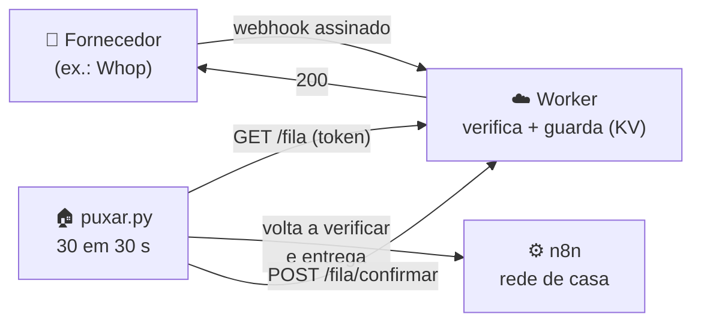

# Recetor de webhooks (Cloudflare Worker) 📨

Um Worker da Cloudflare que **recebe webhooks assinados**, confirma a assinatura, guarda-os numa fila (KV, até 7 dias) e responde `200` logo. Em casa, um script pequeno (`puxar.py`) vai buscá-los de 30 em 30 segundos, **volta a verificar a assinatura**, entrega-os ao teu n8n (ou a outro programa) na rede de casa e só depois confirma ao Worker, que os apaga.



## O problema que resolve

Tens o n8n atrás da Cloudflare (um túnel e um domínio teu) e ligaste o **Bot Fight Mode** para travar robôs. Funciona, mas também trava os **webhooks**: o servidor do fornecedor não é um browser, não resolve o desafio JavaScript e recebe `403 Just a moment…`. No plano gratuito não dá para abrir uma exceção só para um caminho, e desligar a proteção no domínio inteiro abre a porta a tudo.

Um Worker em `<nome>.<a-tua-conta>.workers.dev` está **fora da tua zona**, por isso o Bot Fight Mode não se aplica. O Worker não confia em ninguém: só guarda o que traz uma assinatura válida e recente. E a casa continua sem portas abertas: é ela que vai buscar.

Bónus: se a casa estiver em baixo (falta de luz, n8n a reiniciar), os webhooks ficam à espera no Worker até 7 dias e o fornecedor nunca vê erros (não desliga o webhook por falhas seguidas).

## Que webhooks servem

Os que seguem o formato **[Standard Webhooks](https://www.standardwebhooks.com/)**: cabeçalhos `webhook-id`, `webhook-timestamp` e `webhook-signature: v1,<base64>`, HMAC-SHA256 de `<id>.<timestamp>.<corpo>`. Usam-no, por exemplo, a Whop, o Svix (e quem envia por ele), o Resend e o Clerk. O segredo pode vir na forma `whsec_<base64>` (padrão) ou para usar tal e qual (Whop): o Worker aceita as duas.

Para outro formato (ex.: `X-Hub-Signature-256` do GitHub, `Stripe-Signature`), muda só a função `verificar()` no `worker.js` e no `puxar.py`.

## Instalar o Worker

Precisas de uma conta na Cloudflare (o plano gratuito chega: Workers Free + KV Free) e do Node.js 20+.

```sh
npm install -g wrangler        # ou usa npx wrangler
wrangler login
wrangler kv namespace create FILA          # copia o id para o wrangler.toml
# no wrangler.toml: FONTES = "whop" (ou as tuas, separadas por virgulas)
wrangler secret put TOKEN_FILA             # 32+ caracteres; gera com: python -c "import secrets;print(secrets.token_urlsafe(48))"
wrangler secret put SEGREDO_WHOP           # o segredo que o fornecedor te deu para esse webhook
wrangler deploy
```

O endereço do webhook a pôr no fornecedor é `https://recetor-webhooks.<a-tua-conta>.workers.dev/w/whop` (uma fonte = um caminho = um segredo).

| Pedido | O que faz |
|---|---|
| `POST /w/<fonte>` | verifica a assinatura com `SEGREDO_<FONTE>`, recusa (401) se for falsa ou tiver mais de 5 min, limita o corpo a 256 KB, guarda e responde 200 |
| `GET /fila?depois=<marca>` | (token) eventos por confirmar, por ordem de chegada, 50 de cada vez. Se nada chegou desde a última marca, responde logo vazio sem gastar listagens do KV |
| `POST /fila/confirmar` | (token) `{"chaves": [...]}` apaga-os |
| `GET /saude` | `ok` (para o teu monitor de uptime) |

**Custos:** com o plano gratuito e o `puxar.py` de 30 em 30 s ficas muito abaixo dos limites diários (cerca de 3 000 pedidos e leituras por dia; escritas e apagamentos só por webhook; listagens só quando chega algo novo, mais uma de 10 em 10 min por segurança).

## Instalar o lado de casa

Num Linux com systemd e Python 3 (só biblioteca padrão):

```sh
install -d -m 755 /opt/recetor-webhooks /etc/recetor-webhooks
install -m 644 puxar.py /opt/recetor-webhooks/
install -m 600 .env.exemplo /etc/recetor-webhooks/recetor.env     # e preenche-o
install -m 644 puxar.service puxar.timer /etc/systemd/system/
systemctl daemon-reload && systemctl enable --now puxar.timer
```

| Variável | Para quê |
|---|---|
| `RECETOR_URL` | `https://recetor-webhooks.<a-tua-conta>.workers.dev` |
| `RECETOR_TOKEN` | o mesmo `TOKEN_FILA` do Worker |
| `SEGREDO_<FONTE>` | o mesmo segredo do webhook (a casa verifica outra vez: não confia no Worker às cegas) |
| `DESTINO_<FONTE>` / `DESTINO` | para onde entregar, ex.: `http://10.0.0.20:5678/webhook/webhooks-whop` |
| `REASSINAR_S` | eventos mais velhos do que isto (240 s) são reassinados com o mesmo id antes de entregar, porque o destino provavelmente recusa assinaturas com mais de 5 min |
| `AVISO_URL`, `AVISO_TOKEN`, `AVISO_CANAL` | opcional: aviso no Discord ([discord-aprovacoes](../discord-aprovacoes) `/aviso`) à 6.ª falha seguida |

O destino recebe o **corpo tal como chegou** e os cabeçalhos `webhook-*`, por isso pode (e deve) verificar a assinatura também. Se o destino responder 5xx ou não responder, o evento fica no Worker e tenta-se outra vez com espera crescente (até 5 min). Se responder 400/401/403/422, o evento é descartado (nunca iria passar).

**Uma vez só:** o fornecedor pode repetir um webhook e o `puxar.py` pode entregar duas vezes se cair a meio. Usa o `webhook-id` (ou o id do evento) como chave no destino para ignorar repetições.

## Testar

```sh
node teste.mjs           # 12 testes do Worker, sem rede nem conta na Cloudflare (Node 20+)
python teste_puxar.py    # assinaturas do lado de casa
```

Depois de publicar:

```sh
curl https://recetor-webhooks.<a-tua-conta>.workers.dev/saude      # ok
curl -i https://recetor-webhooks.<a-tua-conta>.workers.dev/fila    # 401 sem token
```

E usa o botão «enviar teste» do fornecedor. No servidor de casa: `python3 /opt/recetor-webhooks/puxar.py ver` (fila sem a tirar) e `journalctl -u puxar.service`.

## Desligar

Do mais leve ao mais forte:

1. Em casa: `systemctl disable --now puxar.timer`. Os webhooks ficam 7 dias no Worker; voltar a ligar entrega-os.
2. No fornecedor: aponta o webhook de volta para onde estava, ou desliga-o.
3. Na Cloudflare: `wrangler delete` (e apaga o KV). Sem o Worker e sem o passo 2, o fornecedor acaba por desativar o webhook por falhas seguidas.
